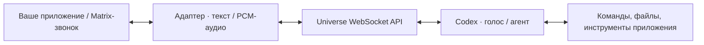

# Universe ChatGPT Voice Assistant

Локальный универсальный голосовой ассистент. Приложения передают текст или PCM-аудио через WebSocket API, получают голос, расшифровки и вызовы зарегистрированных инструментов. MatrixRTC/LiveKit подключается отдельным адаптером. Используется существующий вход Codex через подписку ChatGPT, без отдельного Voice API-ключа.



Уже работают разговор в настоящем Element, выполнение локальных команд и работа с файлами, подключение инструментов через API и выход из звонка по голосовой просьбе. Ядро не зависит от Matrix; для других приложений нужен свой адаптер. Проект пока является локальным прототипом.

Стек: Node.js 26, TypeScript `7.1.0-beta`, esbuild `0.28.2`. Стабильная TypeScript 7.1 на момент установки ещё не опубликована. На Windows для WebRTC используется установленный Microsoft Edge в отдельном временном headless-профиле.

Проверена полная цепочка: голос из зашифрованного Matrix-звонка → подписочный Codex → реальная локальная команда → голосовой ответ участнику. Проверены `node --version`, запрос оперативной памяти штатным shell-инструментом и создание файла самим агентом. Также проверена страница ручного входа с тестовым микрофонным устройством, выключением микрофона и завершением звонка.

## Подготовка на Windows

Понадобятся Node.js 26, Git, Docker Desktop с Compose, Microsoft Edge и авторизованный Codex CLI. Проверенная версия CLI — `0.167.1`; экспериментальный голосовой протокол может меняться между версиями. Авторизация используется с этой машины, копировать токены в проект не нужно.

```powershell
git clone https://github.com/HuHguZ/universe-chatgpt-voice-assistant.git
cd universe-chatgpt-voice-assistant
npm.cmd ci
codex.cmd login
```

Если Codex уже авторизован, достаточно `codex.cmd login status`. Следующие команды выполнять из корня репозитория. Проверки с синтетической русской речью используют Windows SAPI; Linux и macOS отдельно не проверены.

## Позвонить боту из Matrix

```powershell
npm.cmd run matrix:up
npm.cmd run build
npm.cmd start
# В другом терминале:
npm.cmd run matrix:native
```

Открыть **http://127.0.0.1:18795/matrix**: одноразовый токен автоматически войдёт в настоящий Element и откроет приватный чат **Universe**. Логин и пароль вводить не нужно. Нажать кнопку голосового звонка в заголовке чата и разрешить микрофон. Бот постоянно синхронизирует криптоустройство, подготавливает Codex перед ответом и подключается к звонку. Завершение и повторный звонок проверены.

По просьбе «заверши звонок» или «выйди из звонка» агент вызывает `end_call`: адаптер выходит из текущего RTC-вызова и оставляет бота онлайн для следующего. Пока собеседник остаётся в прежнем звонке, бот обратно не подключается. Этот же инструмент зарегистрирован на отдельной тестовой странице ниже. Другие приложения могут предоставить его через `session.start.tools` и выполнить выход в своём адаптере.

Аккаунты создаются только для этого локального стенда. При остановке адаптера их сессии отзываются; после запуска создаётся новая тестовая комната. Протокол, авторизация, зафиксированный виджет и проверка звука описаны в [Native Matrix adapter](docs/matrix-native.md).

## Отдельная тестовая страница разговора

```powershell
npm.cmd run matrix:up
npm.cmd run build
npm.cmd run demo
```

Открыть **http://127.0.0.1:18794** в Chrome или Edge, нажать «Войти в звонок», разрешить микрофон и дождаться «Universe слушает». Регистрация не нужна: два временных Matrix-устройства и приватная зашифрованная комната создаются автоматически. Это собственная страница звонка Universe, использующая тот же MatrixRTC/LiveKit-адаптер. Есть кнопки выключения микрофона и завершения звонка; закрытие страницы также завершает сессию. Токены остаются в памяти, голос не записывается. Доступен один локальный разговор; ссылка не опубликована в сеть.

При выходе во время подключения продолжение старой попытки не включает микрофон. Позднее разрешение микрофона после выхода немедленно останавливает полученный поток. Автоматические проверки используют синтетическую речь через браузерное тестовое устройство, без записи человеческого микрофона.

## Запуск

Из корня проекта:

```powershell
npm.cmd ci
codex.cmd login status
npm.cmd run check
npm.cmd test
npm.cmd run build
npm.cmd start
```

API: `http://127.0.0.1:18793/health`, WebSocket `ws://127.0.0.1:18793/session`. Одновременно поддерживается один владелец сессии. Отключение клиента закрывает Codex-процесс и аудиобраузер. Для смены порта задать `SONORA_PORT`.

## Проверки на настоящих сервисах

Проверки, запускающие Codex, используют лимиты подписки ChatGPT. `smoke:native` и `smoke:matrix` проверяют транспорт без модели; unit-тесты к сервису не обращаются.

```powershell
npm.cmd run smoke
npm.cmd run smoke:agent
npm.cmd run smoke:memory
npm.cmd run smoke:native
npm.cmd run smoke:native-agent
npm.cmd run smoke:hangup
npm.cmd run smoke:voice
npm.cmd run probe
npm.cmd run matrix:up
node infra/lab.mjs
npm.cmd run smoke:matrix
npm.cmd run smoke:e2e
npm.cmd run smoke:command
```

- `smoke`: Codex вызывает `system_time` и клиентский `node_version`; обработчик запускает локальный `node --version` и возвращает результат модели.
- `smoke:agent`: сам Codex использует штатный shell для чтения ОЗУ и создаёт тестовый файл; результат сверяется с памятью реального хоста и содержимым файла.
- `smoke:memory`: голосовой запрос об ОЗУ из Matrix → штатный shell Codex → озвученный объём памяти, сверенный с хостом.
- `smoke:native`: настоящий Element, автоответ, шифрованные различимые тоны в обе стороны, mute/unmute и повторный звонок; модель не запускается.
- `smoke:native-agent`: настоящий чат Element и его кнопка звонка → подписочный Codex → штатные команды проверки ОЗУ → подтверждённый голосовой ответ в Element. Проверка прошла после переименования папки проекта.
- `smoke:hangup`: голосовая просьба завершить звонок в настоящем Element → `end_call` → фактическое отключение бота от RTC; бот остаётся онлайн и не подключается обратно в прежний вызов.
- `probe`: синтетическая русская речь → WebRTC Codex → настоящий `system_time` → голосовой ответ. Тестовая запись создаётся офлайн Windows SAPI, микрофон не включается.
- `smoke:voice`: та же речевая проверка через универсальный WebSocket API Universe.
- `smoke:matrix`: два участника зашифрованного звонка, аудио в обе стороны, профиль робота и смена медиаключа после выхода участника.
- `smoke:e2e`: речевой запрос из Matrix-звонка через API Universe к Codex, вызов инструмента и возврат голоса вызывающему участнику. Создаёт временные тестовые устройства и закрывает их после проверки.
- `smoke:command`: полный Matrix-сценарий с голосовым запросом версии Node.js и реальным запуском команды клиентским обработчиком. Для повторяемой демонстрации достаточно этой команды при работающем Docker-стенде. Звук проверяется в PCM; headless-клиенты не включают колонки.

Локальный Synapse: `http://127.0.0.1:18008`, Element: `http://127.0.0.1:18081`. Стенд использует отдельный Compose-проект и не меняет существующие серверы. Остановка стенда с сохранением данных: `npm.cmd run matrix:down`.

## Интеграция

- [Протокол API и пример локального действия](docs/api.md).
- [Архитектура и подписочный голос](docs/architecture.md).
- [Docker-стенд](docs/local-matrix.md).
- [Matrix-адаптер и ограничения криптоустройства](docs/matrix-adapter.md).
- [Настоящий чат и звонок в Element](docs/matrix-native.md).
- [Источники, включая Alisa Voice Assistant](docs/research.md).

Qdrant не входит в текущий объём. Backend — локальный Codex с его штатными shell- и файловыми инструментами. Он наследует sandbox-профиль вашего Codex CLI. Подтверждения в этом headless-прототипе явно настроены на `approvalPolicy: never`: отдельного интерфейса одобрения команд пока нет, недоступные профилю операции будут отклонены. При профиле `danger-full-access` агент получает соответствующие права на хосте. Глобальная конфигурация не меняется. Для коротких голосовых задач поток использует reasoning `medium`.

Дополнительные клиентские функции регистрируются через `session.start.tools`; `tool.call` выполняется на машине клиента. Например, можно подключить специализированное корпоративное приложение. `node_version` остаётся демонстрацией такого расширения, а не единственным способом выполнить команду. Глобальные MCP пользователя отключаются для потока Universe.

Это прототип на экспериментальном голосовом протоколе Codex CLI 0.167.1. Подтверждённый локальный доступ аккаунта не гарантирует неизменность сервиса, лимитов или возможность распространения общего сервиса на личной подписке. Новое непроверенное Matrix-устройство пока должно быть онлайн до начала звонка: холодное подключение требует постоянного криптохранилища и проверки устройств. Настоящий интерфейс звонка Element проверен с синтетической речью; длительные разговоры и восстановление постоянного устройства после перезапуска пока не подтверждены.

Токены и профили авторизации не копируются в проект. Конфигурация Docker содержит публичные dev-ключи и предназначена только для loopback; реальные секреты в эти файлы не помещать.

## Источники и вдохновение

[Alisa ChatGPT Voice Assistant](https://github.com/rison1337/Alisa-ChatGPT-voice-assistant) послужил ориентиром для исследования подписочного голоса и WebRTC. Реализация Universe использует отдельное ядро с API и адаптер MatrixRTC. Технические источники и границы проверенного описаны в [исследовании](docs/research.md).
