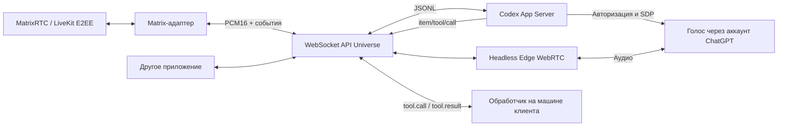

# Архитектура Universe

Локальное ядро с одним владельцем и одной сессией. [API Universe](api.md) — собственный интерфейс проекта.

## Голос и авторизация

Universe запускает установленный `codex app-server`, использующий существующий вход пользователя. Проверяется тип аккаунта `chatgpt`. Токены не передаются приложению или аудиобраузеру. Эфемерный поток наследует локальный sandbox-профиль Codex CLI; `approvalPolicy: never` остаётся явной настройкой headless-прототипа, а не наследованием пользовательского approval-режима. Принудительный read-only sandbox и запрет штатных команд убраны: агент может пользоваться своими shell- и файловыми инструментами. На проверенной машине CLI уже имеет `danger-full-access` / `never`; глобальная конфигурация не меняется. Внешние MCP, приложения и плагины для потока отключены.

Для подписочного голоса проверен `thread/realtime/start` с `version: "v3"`, `outputModality: "audio"` и `transport: {type: "webrtc", sdp}`. SDP answer приходит через `thread/realtime/sdp`. Временный headless Edge обменивается аудио с сервисом; Node передаёт PCM через Web Audio. Используется negotiated data channel `oai-events`, id 0, как в изученном Alisa Voice Assistant.

WebSocket-транспорт голоса в установленной версии требует API-ключ; Universe его не использует. Наличие `appendAudio` в схеме само по себе не означает подписочный доступ по этому маршруту. `appendText` служит контекстом голоса; полноценное текстовое поручение отправляется через `turn/start` и `turn/steer`.

Голосовая модель делегирует актуальные факты и действия backend-агенту Codex. Его результат передаётся голосовой сессии механизмом Codex. Prompt требует говорить только подтверждённый результат. Текущая проверка относится к Codex CLI 0.167.1 и этому аккаунту; формат экспериментальный.

В ранних запусках RTP соединялся и передавал речь, но ответ и делегирование не начинались; иногда приходил `transport_closed`. Задержка после открытия data channel и предварительное создание браузера не исправили это. После согласования описания инструмента и явного `system_time` в backend-инструкции прошли API-голос, Matrix-время и Matrix-команда. Точная причина внутри экспериментального сервиса не установлена: успешные проверки не доказывают стабильность при длительной работе. При повторении запуск должен завершаться ошибкой, а не выдавать фиктивный результат.

## Инструменты

Обычные локальные действия выполняет сам Codex своими штатными shell- и файловыми инструментами. Встроенный `system_time` и дополнительные `session.start.tools` дополняют эти возможности. Для клиентских функций Universe отдаёт `tool.call`, клиент проверяет аргументы, выполняет действие и возвращает `tool.result`. Дедупликация по callId предотвращает повторное выполнение при повторной доставке. Таймаут клиентского инструмента — 30 секунд. Для штатных команд `item/started` и `item/completed` превращаются в `tool.started` / `tool.completed` с именами `shell` и `files`; сырые команды и вывод в эти события не копируются.

Штатные команды выполняются на машине backend Codex. Авторизация на сервере не даёт автоматический доступ к отдельному рабочему компьютеру. Клиентские функции могут работать на другой машине; `scripts/smoke.ts` показывает фиксированный `node --version`. В `scripts/agent-smoke.ts` агент сам выбирает системные команды, получает общую и свободную память и создаёт проверяемый файл. Прерывание не откатывает уже совершённые действия. Qdrant не входит в текущий объём.

## Matrix и размещение

`src/matrix/` управляет MatrixRTC membership, per-participant ключами, LiveKit и аудио. Ядро не импортирует Matrix SDK. Ключи остаются внутри временного браузера адаптера. Шифрование обязательно, открытого fallback нет.

Стенд использует MSC4354/MSC4143/MSC4195. Это не доказательство совместимости с любым Matrix-сервером или встроенным звонком Element. Пока оба клиента должны быть онлайн до первых зашифрованных RTC memberships. Позднее холодное подключение воспроизводимо не проходит; нужны постоянное криптохранилище и проверка устройств. См. [Matrix adapter](matrix-adapter.md).

API и Docker слушают только 127.0.0.1. WebSocket проверяет Host/Origin, ограничивает сообщения и очереди. Удалённая аутентификация и многопользовательское распределение прав не реализованы. Явное `session.interrupt` сбрасывает выходное аудио и завершает сессию; для продолжения клиент подключается заново. Ошибка транспорта также закрывает сессию.

Сервер друга не используется для запуска. Для переноса нужны реальные секреты, HTTPS, сетевой ICE/TURN и отдельная проверка авторизации. Локальный эксперимент не подтверждает условия использования подписки в корпоративном hosted-продукте.

## Проверенный результат, 2026-11-11

- `smoke`: два инструмента, один настоящий клиентский процесс `node --version`, оба успешны.
- `smoke:e2e`: 268 слышимых входных кадров из Matrix; `system_time` выполнен; вызывающий получил 12 слышимых кадров после результата.
- `smoke:command`: два успешных запуска; в последнем — 344 слышимых входных кадра, ровно один `node_version` и один локальный процесс; вызывающий получил 135 слышимых кадров после результата. Дождались завершения backend-задачи и подтвердили точную реальную версию Node в расшифровке голосового ответа. Шифрование участников и ключи проверены до передачи запроса. Под «слышимым» подразумевается RMS PCM выше 200, а не субъективная оценка качества речи.
- `smoke:matrix`: зашифрованные различимые тоны в обе стороны и ротация медиаключа при выходе участника.
- `smoke:agent`: штатный shell Codex получил реальную ОЗУ и создал тестовый файл; оба результата проверены независимо. Попытка навязать Windows `workspace-write` давала AccessDenied на запись в Desktop; наследование пользовательского профиля CLI восстановило ожидаемую работу.
- `smoke:memory`: запрос через зашифрованный Matrix-звонок выполнил штатную команду backend и озвучил объём памяти; получено 54 слышимых кадра после результата. На хосте физически 96 ГиБ, Windows видит 93,56 ГиБ.
- Локальные тесты, `tsc --noEmit` и esbuild проходят; проверка кода не оставила важных замечаний после исправлений очереди, прерывания и очистки ресурсов.

В автоматических проверках использовалась синтетическая общедоступная речь Windows SAPI. Пользователь также подтвердил ручной разговор через отдельную тестовую страницу. Нативный адаптер поддерживает чат Element, одноразовый вход, приём вызова, шифрованный звук, mute/unmute и повторный звонок; см. [проверки](matrix-native.md). Длительный разговор и восстановление постоянного криптоустройства после перезапуска пока не подтверждены.
